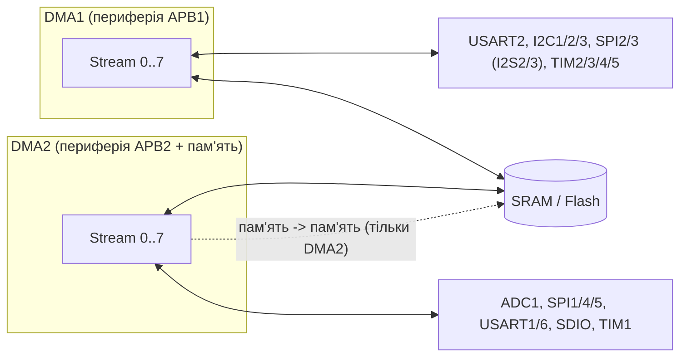

# STM32F411CEU6 (Black Pill)

PlatformIO project. Each program is an env with its own folder in `src/`.

Wiring ST-Link (SWD, not I2C): SWDIO -> DIO, SWCLK -> SCK, 3V3 -> 3V3, GND -> GND.

Build/upload: `pio run -e program1 -t upload`

## DMA на STM32F411

Два контролери DMA, у кожного 8 потоків (Stream 0..7), кожен потік вибирає
один із 8 каналів (Channel 0..7) = яка периферія "смикає" цей потік.
Одночасно потік обслуговує лише один запит.

| DMA  | Напрямки                                   | За що відповідає |
|------|--------------------------------------------|------------------|
| DMA1 | периферія <-> пам'ять                      | повільна периферія шини APB1: USART2, I2C1-3, SPI2/SPI3 (I2S), таймери TIM2-TIM5 |
| DMA2 | периферія <-> пам'ять, **пам'ять -> пам'ять** | швидка периферія шини APB2: ADC1, SPI1/4/5, USART1/6, SDIO, TIM1; копіювання буферів |

### DMA1 request mapping

| Канал \ Потік | S0 | S1 | S2 | S3 | S4 | S5 | S6 | S7 |
|---|---|---|---|---|---|---|---|---|
| Ch0 | SPI3_RX | - | SPI3_RX | SPI2_RX | SPI2_TX | SPI3_TX | - | SPI3_TX |
| Ch1 | **I2C1_RX (p3)** | I2C3_RX | - | - | - | I2C1_RX | I2C1_TX | I2C1_TX |
| Ch2 | TIM4_CH1 | - | I2S3_EXT_RX | TIM4_CH2 | I2S2_EXT_TX | I2S3_EXT_TX | TIM4_UP | TIM4_CH3 |
| Ch3 | I2S3_EXT_RX | TIM2_UP, TIM2_CH3 | I2C3_RX | I2S2_EXT_RX | I2C3_TX | TIM2_CH1 | TIM2_CH2, TIM2_CH4 | TIM2_UP, TIM2_CH4 |
| Ch4 | - | - | - | - | - | **USART2_RX (p2)** | **USART2_TX (p2)** | - |
| Ch5 | - | - | TIM3_CH4, TIM3_UP | - | TIM3_CH1, TIM3_TRIG | TIM3_CH2 | - | TIM3_CH3 |
| Ch6 | TIM5_CH3, TIM5_UP | TIM5_CH4, TIM5_TRIG | TIM5_CH1 | TIM5_CH4, TIM5_TRIG | TIM5_CH2 | - | TIM5_UP | - |
| Ch7 | - | - | I2C2_RX | I2C2_RX | - | - | - | I2C2_TX |

### DMA2 request mapping

| Канал \ Потік | S0 | S1 | S2 | S3 | S4 | S5 | S6 | S7 |
|---|---|---|---|---|---|---|---|---|
| Ch0 | ADC1 | - | - | - | ADC1 | - | TIM1_CH1, TIM1_CH2, TIM1_CH3 | - |
| Ch1 | - | - | - | - | - | - | - | - |
| Ch2 | - | - | - | SPI5_RX | SPI5_TX | - | - | - |
| Ch3 | SPI1_RX | - | **SPI1_RX (p4)** | **SPI1_TX (p4)** | - | SPI1_TX | - | - |
| Ch4 | SPI4_RX | SPI4_TX | USART1_RX | SDIO | - | USART1_RX | SDIO | USART1_TX |
| Ch5 | - | USART6_RX | USART6_RX | SPI4_RX | SPI4_TX | - | USART6_TX | USART6_TX |
| Ch6 | TIM1_TRIG | TIM1_CH1 | TIM1_CH2 | TIM1_CH1 | TIM1_CH4, TIM1_TRIG, TIM1_COM | TIM1_UP | TIM1_CH3 | - |
| Ch7 | - | - | - | - | - | SPI5_RX | SPI5_TX | - |

Пам'ять -> пам'ять: будь-який потік DMA2, канал не важливий
(**p1** використовує DMA2 Stream0).

Джерело: RM0383, таблиці "DMA1/DMA2 request mapping" - звіряйте перед використанням.

### Що використовують програми

| Програма | Що робить DMA | DMA / Stream / Channel |
|---|---|---|
| program1 | пам'ять -> пам'ять | DMA2 S0 (Ch0) |
| program2 | USART2 TX / RX (loopback PA2-PA3) | DMA1 S6 Ch4 / DMA1 S5 Ch4 |
| program3 | I2C1 RX (BME280) | DMA1 S0 Ch1 |
| program4 | SPI1 RX / TX (BME280) | DMA2 S2 Ch3 / DMA2 S3 Ch3 |
