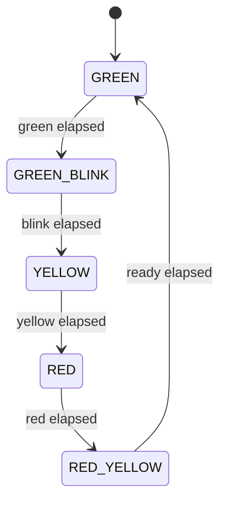

# Traffic Light — ESP32-S3-N16R8 (Arduino / PlatformIO)

> **Status: PLAN ONLY.** This document is the architecture and implementation
> plan. No application code is written yet. Implementation follows after review.

A traffic-light controller for the **ESP32-S3-N16R8** running the **Arduino
framework** under **PlatformIO**. It drives three LEDs (red / yellow / green)
through a deterministic finite-state machine and shows the remaining seconds of
the current phase on a 2-digit seven-segment display. All timing is
non-blocking; the main loop never calls `delay()`.

---

## 1. Goals & Requirements

### Functional
- Cycle the standard phases: `GREEN → GREEN_BLINK → YELLOW → RED → RED_YELLOW → GREEN …`.
- `GREEN_BLINK` blinks green at 500 ms on / 500 ms off before yellow.
- `RED_YELLOW` lights red + yellow together as a "get ready" phase.
- Display the **remaining seconds** of the current logical phase on the
  seven-segment display (counts down, never blinks).
- **Easily reconfigurable sequence**: the number of states, their order, their
  lamp pattern, and their duration are all defined in one `constexpr` table, so
  phases can be added, removed, reordered, or retimed without touching logic.
- Fully configurable phase durations and pin mapping via header files.
- **Serial logging** of every phase transition so behaviour can be demonstrated
  and verified with no display or wiring attached (see §8).

### Non-functional ("perfect architecture")
- **Separation of concerns**: hardware drivers, domain FSM, and timing are
  independent and individually testable.
- **No blocking** in `loop()` — cooperative, time-sliced updates only.
- **No dynamic memory** in application code (no `new` / `malloc`).
- **Deterministic timing** driven by one hardware timer (ISR) as the single
  time base; the loop only renders.
- **Pure domain logic**: the FSM has zero Arduino dependencies so it can be
  unit-tested on a host PC.
- **`constexpr` + `enum class`** for type safety; no magic numbers in logic.

---

## 2. Target Hardware

| Item | Detail |
|---|---|
| Board | ESP32-S3-N16R8 (`4d_systems_esp32s3_gen4_r8n16`) |
| Framework | Arduino (ESP32 core) |
| LEDs | Red, Yellow, Green — active HIGH, cathode → GND via ~330 Ω |
| Display | 2-digit common-anode 7-segment, segments active LOW, multiplexed |

### Pin budget (per `pins.txt`)
Safe "normal" GPIO: `1, 2, 4–11, 12–18, 21, 38, 47, 48`.
Avoid: `19, 20, 26–37` (unusable), `0, 3, 45, 46` (strapping),
`39–44` (JTAG/UART). Final pin numbers are fixed in `pin_map.h` during
implementation and documented here and in `pins.txt`.

Proposed (draft) mapping — confirmed at implementation:

| Signal | GPIO (draft) |
|---|---|
| Red LED | 48 |
| Yellow LED | 47 |
| Green LED | 21 |
| Segments A–G | 4, 5, 6, 7, 15, 16, 17 |
| Digit enable 0/1 | 18, 8 |

---

## 3. Architecture Overview

Layered design — upper layers depend only on the interface below them, never
the reverse.

```
┌─────────────────────────────────────────────┐
│  Application (src/main.cpp)                   │  wiring + loop
├─────────────────────────────────────────────┤
│  Domain: TrafficFsm        (no Arduino deps)  │  pure state logic
├─────────────────────────────────────────────┤
│  Services: TimeBase · Logger                  │  tick source + serial log
├─────────────────────────────────────────────┤
│  Drivers: LedGroup · SevenSegmentDisplay      │  hardware abstraction
├─────────────────────────────────────────────┤
│  Config:  pin_map.h · timing.h · phase_table  │  constants only
└─────────────────────────────────────────────┘
```



### Responsibilities
- **`pin_map.h`** — GPIO assignments only (`constexpr`).
- **`timing.h`** — tick period, blink period, and the per-phase duration
  constants referenced by the phase table (`constexpr`).
- **`phase_table.h`** — the single source of truth for the sequence: an array of
  `PhaseInfo` describing **which** states exist, in **what order**, with **what**
  lamp pattern and duration. Reordering, adding, or removing a row changes the
  whole cycle; no other file needs editing.
- **`LedGroup`** — owns the 3 LED pins; applies a 3-bit mask (R/Y/G).
- **`SevenSegmentDisplay`** — multiplexes 2 digits; renders a 0–99 number;
  non-blocking `scan()` called from the loop.
- **`TrafficFsm`** — pure C++: walks the phase table, advances on elapsed ticks,
  exposes `lampMask()`, `remainingSeconds()`, and `phaseName()`. No hardware,
  no globals, table-driven so it is agnostic to the number/order of states.
- **`TimeBase`** — one `hw_timer_t` ISR increments a millisecond counter; the
  single authoritative clock shared by FSM and display.
- **`Logger`** — thin serial wrapper that prefixes every line with the time
  since boot (`[HH:MM:SS.mmm]`); used to trace transitions without hardware.
- **`main.cpp`** — constructs objects, configures the timer, and in `loop()`
  pushes elapsed time into the FSM, pushes the FSM lamp mask to `LedGroup`,
  pushes the countdown to the display scanner, and logs each transition.

---

## 4. Proposed File Structure

All headers live flat in `include/`, all sources flat in `src/` — no
subfolders.

```
platformio.ini
pins.txt
include/
  pin_map.h                 # constexpr GPIO assignments
  timing.h                  # constexpr tick / blink / duration constants
  phase_table.h             # the sequence: states, order, masks, durations
  led_group.h
  seven_segment_display.h
  traffic_fsm.h             # Arduino-free FSM interface
  time_base.h
  logger.h                  # boot-time-prefixed serial logging
src/
  main.cpp                  # setup()/loop() wiring
  led_group.cpp
  seven_segment_display.cpp
  traffic_fsm.cpp           # Arduino-free, host-testable
  time_base.cpp
  logger.cpp
test/
  test_traffic_fsm/         # native host unit tests for the FSM
```

---

## 5. State / Timing Model (fully reconfigurable)

The FSM is a table of immutable phase descriptors (`constexpr`) in
`phase_table.h`. **The number of states, their order, their lamp pattern, and
their duration are all data** — the FSM logic never hard-codes any of them, so
the whole cycle is changed by editing this one array:

```cpp
struct PhaseInfo {
    const char* name;        // label used by the logger
    uint8_t     lampMask;    // R/Y/G bits (blink resolved at render time)
    uint32_t    durationMs;  // how long this state lasts
    uint8_t     logicalGroup;// phases sharing one countdown share a group id
};

// Edit / reorder / add / remove rows to redefine the entire sequence.
static constexpr PhaseInfo kPhases[] = {
    { "GREEN",       MASK_G,          GREEN_MS,       0 },
    { "GREEN_BLINK", MASK_G,          GREEN_BLINK_MS, 0 },
    { "YELLOW",      MASK_Y,          YELLOW_MS,      1 },
    { "RED",         MASK_R,          RED_MS,         2 },
    { "RED_YELLOW",  MASK_R | MASK_Y, RED_YELLOW_MS,  2 },
};
static constexpr size_t kPhaseCount = sizeof(kPhases) / sizeof(kPhases[0]);
```

- The FSM advances `index = (index + 1) % kPhaseCount`, so **count and order**
  follow the table automatically; no state `enum` switch to maintain.
- Durations are named constants in `timing.h`, so **timing** is tuned in one
  place (or inline in the table).
- Phases sharing a `logicalGroup` share one continuous countdown (e.g. green +
  green-blink), so the display shows a smooth count while blinking is a
  render-time effect.
- **No literals in logic** — everything lives in `phase_table.h` / `timing.h`.

Default timing (editable in `timing.h`):

| Phase | Duration |
|---|---|
| GREEN | 9 s |
| GREEN_BLINK | 3 s |
| YELLOW | 3 s |
| RED | 9 s |
| RED_YELLOW | 2 s |
| Blink period | 500 ms on / 500 ms off |

---

## 6. Build Configuration (PlatformIO)

`platformio.ini` gets a dedicated environment and the include folders:

```ini
[env:traffic_light]
build_src_filter = +<*>
build_flags = -Iinclude

[env:native_test]        ; host unit tests for the pure FSM
platform = native
build_src_filter = +<traffic_fsm.cpp>
```

- `default_envs` set to `traffic_light`.
- Flat `src/`, so the default build picks up every source; host tests compile
  only the Arduino-free `traffic_fsm.cpp`.

---

## 8. Logging (demo without hardware)

The `Logger` service makes the controller observable over USB serial with no
LEDs or display wired. Every line is prefixed with **time since boot**, derived
from the same clock the FSM uses:

- Format: `[HH:MM:SS.mmm] <message>` (e.g. `[00:00:09.000] -> YELLOW (3s)`).
- Logged events:
  - startup banner (board, build env, phase count);
  - every **phase transition**: previous → next, new duration, lamp mask;
  - once-per-second **countdown tick** of the current phase;
  - blink on/off edges during `GREEN_BLINK` (optional, compile-time flag).
- Implementation: `millis()` (or the `TimeBase` counter) formatted to
  `HH:MM:SS.mmm`; a single `Logger::line(const char*)` / `Logger::linef(fmt,...)`
  entry point so call sites stay clean.
- Baud rate 115200 (matches `monitor_speed` in `platformio.ini`).

Example session:

```
[00:00:00.001] Traffic Light boot | env=traffic_light | phases=5
[00:00:00.002] -> GREEN (9s) mask=RYG:001
[00:00:01.002] GREEN  remaining=8s
...
[00:00:09.000] -> GREEN_BLINK (3s) mask=RYG:001
[00:00:12.000] -> YELLOW (3s) mask=RYG:010
[00:00:15.000] -> RED (9s) mask=RYG:100
```

---

## 9. Implementation Steps

1. **Config** — fill `pin_map.h`, `timing.h`, and `phase_table.h`; lock pins
   against `pins.txt`.
2. **Logger** — implement boot-time-prefixed serial logging first so later
   steps are observable.
3. **Drivers** — implement `LedGroup` (mask write) and `SevenSegmentDisplay`
   (multiplexed `scan()`), each verifiable in isolation.
4. **Domain** — implement `TrafficFsm` as pure, table-driven logic.
5. **Service** — implement `TimeBase` hardware-timer tick (ISR-safe counters).
6. **Wiring** — `main.cpp`: construct, configure timer, non-blocking `loop()`,
   log transitions.
7. **Host tests** — `test/test_traffic_fsm` verifies full-cycle order,
   durations, countdown values, and blink boundaries on the PC.
8. **On-target validation** — flash, confirm phase order, countdown, blink, and
   serial log.

---

## 10. Testing Strategy

- **Unit (host, `native` env)**: feed synthetic time into `TrafficFsm`, assert
  state transitions, `remainingSeconds()`, and lamp masks at boundaries. No
  hardware required.
- **On-device**: visual check of sequence, timing, blink, and countdown; serial
  log of each transition for inspection.

---

## 11. Open Questions (confirm before coding)

1. Exact final GPIO numbers — accept the draft map in §2 or adjust?
2. Display type: 2-digit common-anode as assumed, or different module?
3. Keep the ESP32 **hardware-timer** time base, or simpler `millis()`?
4. Phase durations — keep the §5 defaults or use real-world values?
